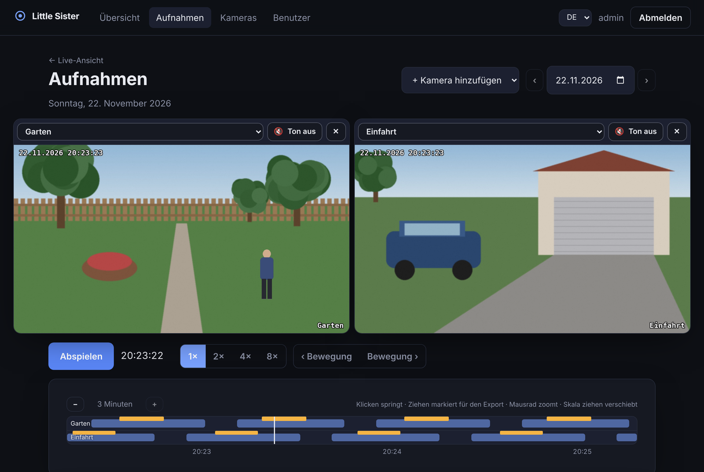
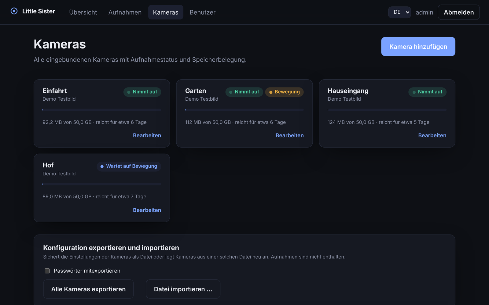
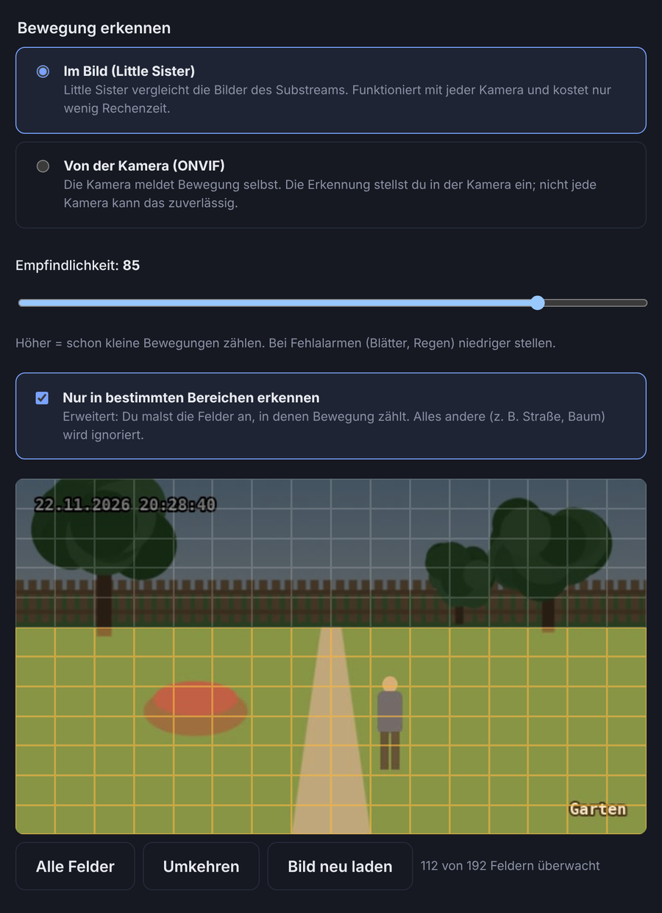

# Little Sister

Selbst gehosteter Dienst für Überwachungskameras: Kameras verwalten, live ansehen, Aufnahmen in einem Ringspeicher ablegen und über eine Zeitleiste mit Bewegungsmarkern abspielen.

| Live-Ansicht | Aufnahmen mit Zeitleiste |
| --- | --- |
|  |  |
| **Kameras** | **Bewegungserkennung mit Erkennungsbereichen** |
|  |  |

<sub>Screenshots mit gezeichneten Demo-Testbildern.</sub>

## Funktionen

- **Kameras** per ONVIF-Suche oder RTSP-Adresse hinzufügen; Zugangsdaten verschlüsselt gespeichert; Konfiguration als JSON exportieren und importieren.
- **Live-Ansicht** über go2rtc (WebRTC, MSE als Rückfall): Kachelraster mit Substream, Einzelansicht mit voller Auflösung, Ton, Drehung und Vollbild. Kamerastatus live per SignalR.
- **Aufnahme** dauerhaft oder **bei Bewegung** (eigene Bilderkennung oder ONVIF-Ereignisse, Vor- und Nachlauf, Erkennungsbereiche). Ein ffmpeg-Prozess je Kamera, Segmente ohne Umwandlung, Neustart bei Ausfall.
- **Ringspeicher** mit Kontingent je Kamera, maximaler Aufbewahrung und globaler Freispeichergrenze.
- **Wiedergabe**: Zeitleiste je Tag mit Vorschaubildern und Bewegungsmarkern, 1×–8×, bis zu neun Kameras synchron, Export eines Zeitraums als MP4.
- **Benutzer** mit Rollen Admin/Betrachter, Login per Cookie (Web) oder Token (Apps).

Technik: ASP.NET Core (.NET 10) mit EF Core und SQLite, SvelteKit + TypeScript als statische Single-Page-App, go2rtc und ffmpeg als eigene Prozesse. Betrieb als systemd-Dienst auf einem Ubuntu-Server oder als Docker-Container (z. B. Unraid).

## Installation

Es gibt zwei Wege. Beide richten nach dem Start einen Einrichtungsassistenten unter `http://<server>:8080` ein (Admin-Konto, Aufnahmeordner, Sprache, Zeitzone).

| Weg | Geeignet für |
| --- | --- |
| [Ubuntu-Server](#ubuntu-server) | eigener Server oder VM; Little Sister läuft als systemd-Dienst |
| [Docker auf Unraid](#docker-auf-unraid) | Unraid oder ein anderer Docker-Host; fertiges Image `ghcr.io/malte007/little_sister` |

### Ubuntu-Server

**1. Installieren** (auf dem Server, als normaler Benutzer mit sudo-Recht):

```fish
curl -fsSLO https://github.com/Malte007/Little_Sister/releases/latest/download/install-ubuntu.sh
bash install-ubuntu.sh --release
```

| Zeile | Wirkung |
| --- | --- |
| `curl -fsSLO …` | lädt das Installationsskript des neuesten Release |
| `bash install-ubuntu.sh --release` | installiert fehlende Pakete (ASP.NET-Core-Laufzeit, ffmpeg) nach Rückfrage, lädt Little Sister samt go2rtc, richtet den Dienst ein und startet ihn |

Das Skript fragt einmal nach dem Port (Enter = 8080).

**2. Einrichten:** `http://<server>:8080` im Browser öffnen und den Assistenten durchklicken. Den vorgeschlagenen Aufnahmeordner `/srv/little-sister/recordings` übernehmen. Ein anderer Ordner muss dem Benutzer `littlesister` gehören (`sudo chown -R littlesister: <ordner>`); liegt er auf einer Netzfreigabe oder eigenen Platte, [diesen Abschnitt](#aufnahmeordner-auf-netzfreigabe-oder-eigener-platte) lesen.

**3. Firewall** (nur wenn ufw aktiv ist): `sudo ufw allow 8080/tcp` und `sudo ufw allow 8555` (WebRTC für die Live-Ansicht).

**Aktualisieren:** dieselben zwei Zeilen wie in Schritt 1 erneut ausführen. Datenbank, Aufnahmen und Einstellungen bleiben erhalten; die Datenbank wird vor Änderungen automatisch gesichert.

| Was | Wo |
| --- | --- |
| Programm | `/opt/little-sister/app` |
| Datenbank, Schlüssel, Sicherungen | `/var/lib/little-sister` |
| Einstellungen | `/etc/little-sister/little-sister.env` |
| Protokoll | `journalctl -u little-sister -f` |

<details>
<summary>Sonderfälle: privates Repository, bestimmte Version, aus dem Quellcode bauen</summary>

- **Privates Repository:** GitHub verlangt dann für den Download eine Anmeldung. Ein Fine-grained-Token mit Lesezugriff auf **Contents** anlegen und so installieren:

  ```fish
  set -x GITHUB_TOKEN github_pat_…
  curl -fsSL -H "Authorization: Bearer $GITHUB_TOKEN" -H "Accept: application/vnd.github.raw" -o install-ubuntu.sh https://api.github.com/repos/Malte007/Little_Sister/contents/scripts/install-ubuntu.sh
  bash install-ubuntu.sh --release
  ```

  | Zeile | Wirkung |
  | --- | --- |
  | `set -x GITHUB_TOKEN …` | merkt sich das Token für diese Terminal-Sitzung; das Skript lädt damit das Paket |
  | `curl … contents/scripts/install-ubuntu.sh` | lädt das Skript über die GitHub-API |
  | `bash install-ubuntu.sh --release` | installiert wie oben |

- **Bestimmte Version:** `bash install-ubuntu.sh --release v0.9.0`.
- **Aus dem Quellcode** (Entwicklungsstand ohne Release, braucht .NET 10 SDK, Node.js 24 und git): Repository klonen und darin `./scripts/install-ubuntu.sh` ohne `--release` ausführen.

</details>

### Docker auf Unraid

Das Image wird bei jedem Versions-Tag von GitHub gebaut: `ghcr.io/malte007/little_sister:latest` (neueste Version) bzw. `…:0.9.0` (genau diese Version).

**0. Einmalig: Image öffentlich machen.** Das Image-Paket hat eine eigene Sichtbarkeit, die nicht automatisch der des Repositorys folgt. Auf GitHub: **Profil → Packages → little_sister → Package settings → Change visibility → Public** ([direkt dorthin](https://github.com/users/Malte007/packages/container/little_sister/settings)). Danach kann Unraid das Image ohne Anmeldung laden.

<details>
<summary>Paket privat lassen? Dann Unraid bei ghcr.io anmelden</summary>

Auf GitHub ein **Token (classic)** nur mit dem Recht `read:packages` anlegen (**Settings → Developer settings → Personal access tokens → Tokens (classic)**). Dann im Unraid-Terminal (**>_** oben rechts, dort läuft bash):

```bash
docker login ghcr.io -u malte007
mkdir -p /boot/config/docker-auth && cp /root/.docker/config.json /boot/config/docker-auth/
echo 'mkdir -p /root/.docker && cp /boot/config/docker-auth/config.json /root/.docker/' >> /boot/config/go
```

| Zeile | Wirkung |
| --- | --- |
| `docker login ghcr.io -u malte007` | meldet Docker bei ghcr.io an; als Passwort das Token einfügen |
| `mkdir … && cp …` | sichert die Anmeldung auf dem USB-Stick (`/root` ist nach einem Neustart leer) |
| `echo … >> /boot/config/go` | stellt die Anmeldung bei jedem Start von Unraid wieder her |

</details>

**1. Container anlegen.** In Unraid **Docker → Container hinzufügen** (Add Container), Vorlage leer lassen, oben rechts **Erweiterte Ansicht** einschalten und eintragen:

| Feld | Wert |
| --- | --- |
| Name | `little-sister` |
| Repository | `ghcr.io/malte007/little_sister:latest` |
| Netzwerktyp | `Host` |
| WebUI | `http://[IP]:8080/` |
| Zusätzliche Parameter (Extra Parameters) | `--user 99:100` |

Dann über **Weiteren Pfad, Port, Variable … hinzufügen** (Add another Path, Port, Variable…) zwei Pfade und eine Variable anlegen:

| Typ | Container-Pfad / Schlüssel | Wert auf Unraid |
| --- | --- | --- |
| Pfad | `/data` | `/mnt/user/appdata/little-sister` |
| Pfad | `/recordings` | z. B. `/mnt/user/aufnahmen/little-sister` |
| Variable | `TZ` | `Europe/Berlin` |

Warum so:

- **Host-Netzwerk**, damit die ONVIF-Kamerasuche (Multicast) und WebRTC ohne weitere Einstellungen funktionieren. Little Sister belegt damit direkt die Ports **8080** (Oberfläche), **8555 TCP/UDP** (WebRTC) und **1984** (go2rtc, nur intern).
- **`--user 99:100`** lässt den Container als Unraid-Standardbenutzer `nobody:users` laufen; sonst fehlen Schreibrechte auf den Shares.
- **Aufnahme-Share** am besten ohne Cache anlegen, sonst verschiebt der Mover die Aufnahmen ständig.

**2. Starten und einrichten.** **Anwenden** (Apply) klicken; Unraid lädt das Image und startet den Container. Danach im Docker-Reiter beim Container **WebUI** öffnen (oder `http://<unraid-ip>:8080`) und den Assistenten durchklicken. Als Aufnahmeordner `/recordings` stehen lassen.

**3. Aktualisieren.** Nach einer neuen Version auf Unraid **Docker → Nach Updates suchen** (Check for Updates) und beim Container **Update anwenden**. Datenbank-Migrationen laufen beim Start, vorher wird die Datenbank nach `/data/backups` gesichert.

Andere Docker-Hosts: Die `docker-compose.yml` im Repository enthält dieselben Einstellungen; im Ordner mit der Datei `docker compose up -d` ausführen.

### Port nachträglich ändern

Standard ist **8080**. Belegt schon ein anderes Programm den Port, oder soll Little Sister unter einem anderen Port laufen:

**Ubuntu-Server**

```fish
sudo sed -i 's/^ASPNETCORE_HTTP_PORTS=.*/ASPNETCORE_HTTP_PORTS=9000/' /etc/little-sister/little-sister.env
sudo systemctl restart little-sister
sudo ufw allow 9000/tcp
```

| Zeile | Wirkung |
| --- | --- |
| `sudo sed -i …` | setzt in der Einstellungsdatei den Port auf 9000 (Zahl nach Wunsch ändern); alternativ die Datei mit `sudo nano /etc/little-sister/little-sister.env` von Hand bearbeiten |
| `sudo systemctl restart little-sister` | startet den Dienst mit dem neuen Port neu |
| `sudo ufw allow 9000/tcp` | gibt den neuen Port in der Firewall frei (nur nötig, wenn ufw aktiv ist) |

Danach ist Little Sister unter `http://<server>:9000` erreichbar. Spätere Updates behalten den Port.

**Docker auf Unraid**

1. Im Docker-Reiter auf das Symbol des Containers klicken → **Bearbeiten** (Edit).
2. **Weiteren Pfad, Port, Variable … hinzufügen** → Typ **Variable**, Schlüssel `ASPNETCORE_HTTP_PORTS`, Wert `9000`.
3. Das Feld **WebUI** auf `http://[IP]:9000/` ändern.
4. **Anwenden** klicken; der Container startet mit dem neuen Port neu.

Mit Host-Netzwerk gibt es keine Portzuordnung, deshalb wird der Port über die Variable geändert. Läuft auf Unraid schon ein anderes go2rtc oder Frigate, lassen sich auch die anderen Ports so umlegen: `LittleSister__Live__WebRtcPort` (statt 8555) und `LittleSister__Live__ApiPort` (statt 1984).

## Betrieb

### Live-Ansicht

Little Sister startet go2rtc selbst und hält dessen Streams mit den Kameras in Sync. Die go2rtc-API lauscht nur auf `127.0.0.1`; der Browser bekommt Bilder ausschließlich über die angemeldete Little-Sister-API. Für WebRTC (Latenz unter einer Sekunde) muss Port **8555 TCP und UDP** erreichbar sein, sonst fällt der Player auf MSE zurück (etwas mehr Verzögerung). Fehlt go2rtc, ist nur die Live-Ansicht aus; die Aufnahme läuft weiter.

### Wiedergabe und Export

Unter **Aufnahmen** zeigt die Zeitleiste je Kamera und Tag, wann aufgenommen wurde; Lücken werden beim Abspielen übersprungen. Abgespielt wird per HLS direkt aus den gespeicherten Segmenten, ohne Umwandlung und ohne CPU-Last auf dem Server. Der Export setzt den markierten Zeitraum ebenfalls ohne Umwandlung zu einer MP4-Datei zusammen (ab dem Schlüsselbild vor dem Anfang, eine Datei je Kamera). Uhrzeiten richten sich nach der Zeitzone der Installation.

- **Mehrere Kameras:** Über **+ Kamera hinzufügen** laufen bis zu neun Kameras synchron über dieselbe Zeitleiste. Hat eine Kamera zur aktuellen Zeit keine Aufnahme, pausiert sie. Jede Kamera dekodiert im Browser; viele 4K-Kameras können einen schwachen Rechner überfordern.
- **Vorschaubilder:** Beim Überfahren der Zeitleiste erscheint ein Vorschaubild. Little Sister legt dafür je Segment einen Bildstreifen an (ein Bild alle 10 s, aus den Schlüsselbildern, wenig Rechenzeit; für alte Aufnahmen beim ersten Überfahren). Abschaltbar unter **Kameras → Speicher**.

### Aufnahme bei Bewegung

Je Kamera unter **Kameras → Bearbeiten**: Aufnahmeart **Dauerhaft**, **Bei Bewegung** oder **Aus**. Bewegung wird auf zwei Arten erkannt:

| Erkennung | Wie | Voraussetzung |
| --- | --- | --- |
| **Im Bild** (Standard) | ffmpeg dekodiert den Substream (5 Bilder/s, 80×60 Graustufen); Little Sister zählt Pixel, die deutlich vom gleitenden Hintergrund abweichen. Regler **Empfindlichkeit**: 1 = 10 % des Bildes, 50 ≈ 1,4 %, 100 = 0,2 %. Nach 3 s Ruhe endet die Bewegung; ändert sich fast das ganze Bild (Licht, Nachtsicht), zählt das nicht. | jede Kamera; Substream empfohlen. CPU: ca. 3 % eines Kerns bei 640×360, 6 % bei 1280×720 |
| **Von der Kamera (ONVIF)** | Die Kamera meldet Bewegung per ONVIF-Ereignis. | ONVIF-Adresse (`http://IP:Port`) und eingeschaltete Erkennung in der Kamera; viele günstige Kameras können das nur teilweise |

Mit **Nur in bestimmten Bereichen erkennen** wird das Standbild in 16×12 Felder geteilt; per Klicken und Ziehen markierte Felder werden überwacht, der Rest (Straße, Baum, Nachbargrundstück) ignoriert.

| Vorlauf | Verhalten |
| --- | --- |
| 0 s | ffmpeg startet erst mit der Bewegung und endet nach dem Nachlauf. Die ersten 1–3 s bis zum Verbindungsaufbau fehlen. |
| > 0 s | Der Stream läuft dauernd in einen kurzen Zwischenspeicher (`.buffer`); bei Bewegung wird das Stück davor übernommen. |

Der Nachlauf (0–600 s) bestimmt, wie lange nach der Bewegung weiter aufgenommen wird. Bewegungen erscheinen als gelbe Balken auf der Zeitleiste, **‹ Bewegung** und **Bewegung ›** springen dorthin. Im Kamerastatus bedeutet **Wartet auf Bewegung**, dass gerade nichts gespeichert wird. Bei Daueraufnahme werden Bewegungen nur per ONVIF markiert (die Bilderkennung läuft nur im Modus „Bei Bewegung“).

ONVIF-Meldungen holt Little Sister bevorzugt selbst ab (PullPoint). Kann die Kamera das nicht („ActionNotSupported“), schickt sie sie per HTTP an `http://<server>:<port>/api/onvif/events/<schlüssel>`. Dafür muss die Kamera den Server über den HTTP-Port erreichen; hinter NAT lässt sich die Adresse mit `LittleSister__Events__CallbackUrl` vorgeben.

### Kamera-Konfiguration exportieren und importieren

Admins sichern Kameras unter **Kameras → Alle Kameras exportieren** (oder einzeln beim Bearbeiten) als JSON und spielen sie über **Datei importieren …** wieder ein. Enthalten sind alle Einstellungen samt Erkennungsbereichen, aber keine Aufnahmen. Passwörter nur mit Haken **Passwörter mitexportieren**, dann im **Klartext** – die Datei also wie ein Passwort behandeln. Der Import legt immer neue Kameras an (bei gleichem Namen mit „(2)“ usw.); ist eine Kamera ungültig, wird keine angelegt.

### Ablage der Aufnahmen

```
recordings/<kamera-id>/<JJJJMMTT>/<HHMMSS>.mp4   fertige Segmente (Zeiten in UTC)
recordings/<kamera-id>/<JJJJMMTT>/<HHMMSS>.jpg   Vorschaubilder des Segments
recordings/<kamera-id>/.incoming/                 Segment, das gerade geschrieben wird
recordings/<kamera-id>/.buffer/                   Zwischenspeicher für den Vorlauf
recordings/.little-sister                         Kennung des Aufnahmeordners, nicht löschen
```

Segmente sind fragmentierte MP4-Dateien und lassen sich mit jedem Player öffnen. Beim Start liest Little Sister Segmente nach diesem Schema ein, die in der Datenbank fehlen (z. B. nach einer wiederhergestellten Datenbank); danach greift der Ringspeicher wie gewohnt. Alle Aufnahmen einer Kamera löscht ein Admin unter **Kameras → Kamera bearbeiten → Aufnahmen → Alle Aufnahmen löschen** (Bestätigung durch Eintippen des Kameranamens).

### Aufnahmeordner auf Netzfreigabe oder eigener Platte

> **Wichtig:** Die versteckte Datei `.little-sister` im Aufnahmeordner (sichtbar mit `ls -a`) kennzeichnet ihn als eingerichteten Aufnahmeordner. **Nicht löschen.**

Ist eine Freigabe (NFS, SMB, virtiofs) oder Platte beim Start nicht eingehängt, ist der Ordner nur der leere Einhängepunkt auf der Systemplatte. Ohne die Kennung würde Little Sister dorthin aufnehmen, die Systemplatte füllen und wegen der Freispeichergrenze alte Aufnahmen löschen. Fehlt `.little-sister`, gilt deshalb:

- Die Aufnahme pausiert (Kamerastatus „Fehler“: „Aufnahmeordner … nicht erreichbar oder nicht eingehängt“), der Ringspeicher löscht dort nichts.
- Live-Ansicht und Wiedergabe laufen weiter.
- Ist die Freigabe wieder da, startet die Aufnahme innerhalb von 30 s von selbst.

Die Kennung entsteht beim Einrichten oder Wechseln des Aufnahmeordners, bei älteren Installationen automatisch, wenn eine der 20 ältesten bekannten Aufnahmen im Ordner gefunden wird. Von Hand anlegen (nur wenn die Freigabe sicher eingehängt ist):

```fish
findmnt /srv/little-sister/recordings
sudo -u littlesister touch /srv/little-sister/recordings/.little-sister
```

| Zeile | Wirkung |
| --- | --- |
| `findmnt …` | zeigt, was dort eingehängt ist; keine Ausgabe = nicht eingehängt |
| `sudo -u littlesister touch …` | legt die Kennung als Dienstbenutzer an; die Aufnahme startet innerhalb von 30 s |

### Konfiguration

Einstellungen per Umgebungsvariable (doppelter Unterstrich trennt Ebenen): auf dem Ubuntu-Server in `/etc/little-sister/little-sister.env` (danach `sudo systemctl restart little-sister`), bei Docker als Variable des Containers. Bei Docker sind Daten- und Aufnahmeordner fest `/data` und `/recordings`.

| Variable | Standard | Bedeutung |
| --- | --- | --- |
| `ASPNETCORE_HTTP_PORTS` | `8080` | Port für Oberfläche und API |
| `LittleSister__DataPath` | `/var/lib/little-sister` | Datenbank, Schlüssel, Sicherungen |
| `LittleSister__DefaultRecordingsPath` | `/srv/little-sister/recordings` | Vorschlag im Einrichtungsassistenten |
| `LittleSister__Database__Provider` / `__ConnectionString` | `Sqlite` / Datei im Datenordner | Datenbank |
| `LittleSister__KeysPath` | `<DataPath>/keys` | Schlüssel für Cookies und Kamera-Passwörter, getrennt ablegbar |
| `LittleSister__Recording__SegmentSeconds` | `60` | Länge eines Aufnahmesegments |
| `LittleSister__Recording__FfmpegPath` | `ffmpeg` | Pfad zu ffmpeg |
| `LittleSister__Live__Go2rtcPath` | `go2rtc` | Pfad zu go2rtc |
| `LittleSister__Live__ApiPort` | `1984` | go2rtc-API, nur auf 127.0.0.1 |
| `LittleSister__Live__WebRtcPort` | `8555` | WebRTC-Port (TCP und UDP) |
| `LittleSister__Live__WebRtcCandidates__0` | leer | zusätzliche WebRTC-Adresse bei NAT, z. B. `192.168.1.10:8555` |
| `LittleSister__Events__CallbackUrl` | automatisch | Adresse für ONVIF-Meldungen der Kameras, z. B. `http://192.168.1.10:8080` |

## CI und Version veröffentlichen

`.github/workflows/ci.yml` läuft auf GitHub Actions und Gitea Actions; die Logik steckt in `scripts/`. Um das kostenlose Actions-Kontingent zu schonen, läuft sie **nur bei einem Versions-Tag `v*`** (oder von Hand unter Actions → CI → „Run workflow“), nicht bei Commits und Pull Requests. Sie baut, testet, legt das GitHub-Release mit `little-sister.tar.gz` an und veröffentlicht das Docker-Image auf ghcr.io. Vor einem Pull Request deshalb lokal `./scripts/build.sh` ausführen (baut und testet alles wie die CI).

### Version veröffentlichen

In Rider **Git → New Tag…** (z. B. `v0.2.0`), danach **Git → Push…** mit Haken bei **Push Tags**. Oder im Terminal:

```fish
git tag v0.2.0
git push Github v0.2.0
```

| Zeile | Wirkung |
| --- | --- |
| `git tag v0.2.0` | markiert den aktuellen Commit als Version 0.2.0 |
| `git push Github v0.2.0` | schickt den Tag zu GitHub (Remote `Github`); die CI baut, testet und legt das Release an |

Tags mit Zusatz wie `v0.2.1-test` werden als Vorabversion veröffentlicht und nicht zu „latest“.

## Lizenz

Copyright (c) 2026 Malte Hirte.

Little Sister ist freie Software unter der **GNU Affero General Public License, Version 3** (AGPL-3.0-only, Volltext in [LICENSE](LICENSE)).

- Jeder darf Little Sister nutzen, ändern und weitergeben, auch gewerblich. Wer es weitergibt oder eine geänderte Fassung über das Netzwerk für andere betreibt, muss den vollständigen Quellcode unter derselben Lizenz zugänglich machen.
- **Doppellizenz:** Wer Little Sister ohne die Pflichten der AGPL einsetzen möchte (zum Beispiel in einem geschlossenen Produkt), kann beim Urheber eine kommerzielle Lizenz anfragen.
- Mitgelieferte Fremdsoftware und ihre Lizenzen stehen in [THIRD-PARTY-NOTICES](THIRD-PARTY-NOTICES).
- Neue Abhängigkeiten nur mit freizügiger Lizenz (MIT, BSD, Apache 2.0, PostgreSQL-Lizenz), damit die Doppellizenz möglich bleibt. Keine GPL-Bibliotheken im eigenen Prozess; ffmpeg wird nur als eigener Prozess gestartet.
- Beiträge Dritter nur mit Contributor License Agreement, siehe [CONTRIBUTING.md](CONTRIBUTING.md).
