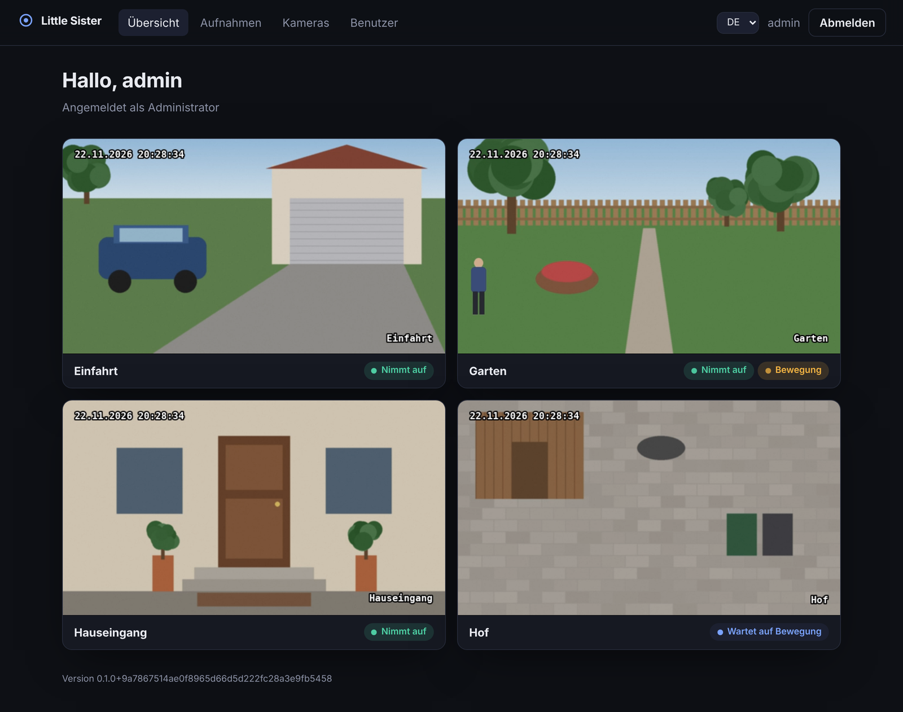

# Little Sister

Selbst gehosteter Dienst für Überwachungskameras: Kameras verwalten, live ansehen, Aufnahmen in einem Ringspeicher ablegen und über eine Zeitleiste mit Bewegungsmarkern abspielen.

| Live-Ansicht | Aufnahmen mit Zeitleiste |
| --- | --- |
|  |  |
| **Kameras** | **Bewegungserkennung mit Erkennungsbereichen** |
|  |  |

<sub>Screenshots mit gezeichneten Demo-Testbildern.</sub>

## Funktionen

- **Kameras** per ONVIF-Suche oder RTSP-Adresse hinzufügen; Zugangsdaten verschlüsselt gespeichert; Konfiguration als JSON exportieren und importieren.
- **Live-Ansicht** über go2rtc (WebRTC, MSE als Rückfall): Kachelraster mit Substream, Einzelansicht mit voller Auflösung, Ton, Drehung und Vollbild. Kamerastatus live per SignalR.
- **Aufnahme** dauerhaft oder **bei Bewegung** (eigene Bilderkennung oder ONVIF-Ereignisse, Vor- und Nachlauf, Erkennungsbereiche). Ein ffmpeg-Prozess je Kamera, Segmente ohne Umwandlung, Neustart bei Ausfall.
- **Ringspeicher** mit Kontingent je Kamera, maximaler Aufbewahrung und globaler Freispeichergrenze.
- **Wiedergabe**: Zeitleiste je Tag mit Vorschaubildern und Bewegungsmarkern, 1×–8×, bis zu neun Kameras synchron, Export eines Zeitraums als MP4.
- **Benutzer** mit Rollen Admin/Betrachter, Login per Cookie (Web) oder Token (Apps).

Technik: ASP.NET Core (.NET 10) mit EF Core und SQLite, SvelteKit + TypeScript als statische Single-Page-App, go2rtc und ffmpeg als eigene Prozesse. Betrieb als systemd-Dienst auf einem Ubuntu-Server.

## Installation auf einem Ubuntu-Server

Das Skript `install-ubuntu.sh` installiert Little Sister nach `/opt/little-sister`, bringt go2rtc mit, legt den Dienstbenutzer `littlesister` an und richtet den systemd-Dienst ein. Fehlende Pakete (.NET, ffmpeg, Node.js) listet es auf und installiert sie nach Rückfrage. Für Updates wird es einfach erneut aufgerufen; Datenbank, Aufnahmen und Einstellungen bleiben erhalten, Datenbank-Migrationen laufen beim Start automatisch (vorher wird gesichert).

| Weg | Auf dem Server nötig | Wann |
| --- | --- | --- |
| **Fertiges Release** (empfohlen) | ASP.NET-Core-Laufzeit 10, ffmpeg | Normalbetrieb, kein Bauen |
| Aus dem Quellcode bauen | .NET 10 SDK, Node.js ab 22.12, ffmpeg, git | Entwicklungsstand ohne Release testen |

### Fertiges Release

Jeder Versions-Tag erzeugt ein GitHub-Release mit `little-sister.tar.gz` und dem Installationsskript (siehe [Version veröffentlichen](#version-veröffentlichen)).

```fish
curl -fsSLO https://github.com/Malte007/Little_Sister/releases/latest/download/install-ubuntu.sh
bash install-ubuntu.sh --release
```

| Zeile | Wirkung |
| --- | --- |
| `curl -fsSLO …` | lädt das Installationsskript des neuesten Release |
| `bash install-ubuntu.sh --release` | lädt das Paket, prüft die Prüfsumme, installiert und startet den Dienst (fragt nach dem sudo-Passwort) |

Bestimmte Version: `bash install-ubuntu.sh --release v0.2.0`. Aktualisieren: dieselben zwei Zeilen erneut.

**Solange das Repository privat ist**, braucht der Download ein Fine-grained-Token mit Lesezugriff auf **Contents**:

```fish
set -x GITHUB_TOKEN github_pat_…
curl -fsSL -H "Authorization: Bearer $GITHUB_TOKEN" -H "Accept: application/vnd.github.raw" -o install-ubuntu.sh https://api.github.com/repos/Malte007/Little_Sister/contents/scripts/install-ubuntu.sh
bash install-ubuntu.sh --release
```

| Zeile | Wirkung |
| --- | --- |
| `set -x GITHUB_TOKEN …` | merkt sich das Token für diese Terminal-Sitzung |
| `curl … contents/scripts/install-ubuntu.sh` | lädt das Skript über die GitHub-API aus dem privaten Repository |
| `bash install-ubuntu.sh --release` | lädt das Paket mit dem Token (braucht `python3`, auf Ubuntu vorhanden) |

Wer vom Quellcode-Weg auf Releases umsteigt, kann danach SDK und Node.js entfernen. Vorher `sudo apt install -y aspnetcore-runtime-10.0` ausführen, damit apt die Laufzeit nicht mit entfernt.

### Aus dem Quellcode bauen

```fish
git clone https://github.com/malte007/little_sister.git
cd little_sister
./scripts/install-ubuntu.sh
```

| Zeile | Wirkung |
| --- | --- |
| `git clone …` | lädt das Repository herunter (privat: mit GitHub-Benutzer und Token anmelden) |
| `cd little_sister` | wechselt in den Projektordner |
| `./scripts/install-ubuntu.sh` | baut das Paket (`scripts/package.sh`), installiert und startet den Dienst |

Aktualisieren: im Projektordner `git pull` und danach erneut `./scripts/install-ubuntu.sh`.

### Nach der Installation

Bei der Erstinstallation fragt das Skript nach dem Port (Enter = 8080); ohne Rückfrage geht es mit `env HTTP_PORT=9000 bash install-ubuntu.sh --release`. Danach `http://<server>:<port>` öffnen, der Einrichtungsassistent startet automatisch. Vorgeschlagener Aufnahmeordner ist `/srv/little-sister/recordings`; ein anderer Ordner muss dem Benutzer `littlesister` gehören (`sudo chown -R littlesister: <ordner>`). Liegt er auf einer Netzfreigabe oder eigenen Platte, unbedingt [diesen Abschnitt](#aufnahmeordner-auf-netzfreigabe-oder-eigener-platte) lesen.

| Was | Wo |
| --- | --- |
| Programm | `/opt/little-sister/app` |
| Datenbank, Schlüssel, Sicherungen | `/var/lib/little-sister` |
| Einstellungen (siehe [Konfiguration](#konfiguration)) | `/etc/little-sister/little-sister.env`, danach `sudo systemctl restart little-sister` |
| Protokoll | `journalctl -u little-sister -f` |

Port später ändern: in der Einstellungsdatei `ASPNETCORE_HTTP_PORTS` setzen und den Dienst neu starten. Mit aktiver Firewall (ufw) müssen der Oberflächen-Port und 8555 TCP/UDP (WebRTC) frei sein: `sudo ufw allow 8080/tcp`, `sudo ufw allow 8555`.

## Betrieb

### Live-Ansicht

Little Sister startet go2rtc selbst und hält dessen Streams mit den Kameras in Sync. Die go2rtc-API lauscht nur auf `127.0.0.1`; der Browser bekommt Bilder ausschließlich über die angemeldete Little-Sister-API. Für WebRTC (Latenz unter einer Sekunde) muss Port **8555 TCP und UDP** erreichbar sein, sonst fällt der Player auf MSE zurück (etwas mehr Verzögerung). Fehlt go2rtc, ist nur die Live-Ansicht aus; die Aufnahme läuft weiter.

### Wiedergabe und Export

Unter **Aufnahmen** zeigt die Zeitleiste je Kamera und Tag, wann aufgenommen wurde; Lücken werden beim Abspielen übersprungen. Abgespielt wird per HLS direkt aus den gespeicherten Segmenten, ohne Umwandlung und ohne CPU-Last auf dem Server. Der Export setzt den markierten Zeitraum ebenfalls ohne Umwandlung zu einer MP4-Datei zusammen (ab dem Schlüsselbild vor dem Anfang, eine Datei je Kamera). Uhrzeiten richten sich nach der Zeitzone der Installation.

- **Mehrere Kameras:** Über **+ Kamera hinzufügen** laufen bis zu neun Kameras synchron über dieselbe Zeitleiste. Hat eine Kamera zur aktuellen Zeit keine Aufnahme, pausiert sie. Jede Kamera dekodiert im Browser; viele 4K-Kameras können einen schwachen Rechner überfordern.
- **Vorschaubilder:** Beim Überfahren der Zeitleiste erscheint ein Vorschaubild. Little Sister legt dafür je Segment einen Bildstreifen an (ein Bild alle 10 s, aus den Schlüsselbildern, wenig Rechenzeit; für alte Aufnahmen beim ersten Überfahren). Abschaltbar unter **Kameras → Speicher**.

### Aufnahme bei Bewegung

Je Kamera unter **Kameras → Bearbeiten**: Aufnahmeart **Dauerhaft**, **Bei Bewegung** oder **Aus**. Bewegung wird auf zwei Arten erkannt:

| Erkennung | Wie | Voraussetzung |
| --- | --- | --- |
| **Im Bild** (Standard) | ffmpeg dekodiert den Substream (5 Bilder/s, 80×60 Graustufen); Little Sister zählt Pixel, die deutlich vom gleitenden Hintergrund abweichen. Regler **Empfindlichkeit**: 1 = 10 % des Bildes, 50 ≈ 1,4 %, 100 = 0,2 %. Nach 3 s Ruhe endet die Bewegung; ändert sich fast das ganze Bild (Licht, Nachtsicht), zählt das nicht. | jede Kamera; Substream empfohlen. CPU: ca. 3 % eines Kerns bei 640×360, 6 % bei 1280×720 |
| **Von der Kamera (ONVIF)** | Die Kamera meldet Bewegung per ONVIF-Ereignis. | ONVIF-Adresse (`http://IP:Port`) und eingeschaltete Erkennung in der Kamera; viele günstige Kameras können das nur teilweise |

Mit **Nur in bestimmten Bereichen erkennen** wird das Standbild in 16×12 Felder geteilt; per Klicken und Ziehen markierte Felder werden überwacht, der Rest (Straße, Baum, Nachbargrundstück) ignoriert.

| Vorlauf | Verhalten |
| --- | --- |
| 0 s | ffmpeg startet erst mit der Bewegung und endet nach dem Nachlauf. Die ersten 1–3 s bis zum Verbindungsaufbau fehlen. |
| > 0 s | Der Stream läuft dauernd in einen kurzen Zwischenspeicher (`.buffer`); bei Bewegung wird das Stück davor übernommen. |

Der Nachlauf (0–600 s) bestimmt, wie lange nach der Bewegung weiter aufgenommen wird. Bewegungen erscheinen als gelbe Balken auf der Zeitleiste, **‹ Bewegung** und **Bewegung ›** springen dorthin. Im Kamerastatus bedeutet **Wartet auf Bewegung**, dass gerade nichts gespeichert wird. Bei Daueraufnahme werden Bewegungen nur per ONVIF markiert (die Bilderkennung läuft nur im Modus „Bei Bewegung“).

ONVIF-Meldungen holt Little Sister bevorzugt selbst ab (PullPoint). Kann die Kamera das nicht („ActionNotSupported“), schickt sie sie per HTTP an `http://<server>:<port>/api/onvif/events/<schlüssel>`. Dafür muss die Kamera den Server über den HTTP-Port erreichen; hinter NAT lässt sich die Adresse mit `LittleSister__Events__CallbackUrl` vorgeben.

### Kamera-Konfiguration exportieren und importieren

Admins sichern Kameras unter **Kameras → Alle Kameras exportieren** (oder einzeln beim Bearbeiten) als JSON und spielen sie über **Datei importieren …** wieder ein. Enthalten sind alle Einstellungen samt Erkennungsbereichen, aber keine Aufnahmen. Passwörter nur mit Haken **Passwörter mitexportieren**, dann im **Klartext** – die Datei also wie ein Passwort behandeln. Der Import legt immer neue Kameras an (bei gleichem Namen mit „(2)“ usw.); ist eine Kamera ungültig, wird keine angelegt.

### Ablage der Aufnahmen

```
recordings/<kamera-id>/<JJJJMMTT>/<HHMMSS>.mp4   fertige Segmente (Zeiten in UTC)
recordings/<kamera-id>/<JJJJMMTT>/<HHMMSS>.jpg   Vorschaubilder des Segments
recordings/<kamera-id>/.incoming/                 Segment, das gerade geschrieben wird
recordings/<kamera-id>/.buffer/                   Zwischenspeicher für den Vorlauf
recordings/.little-sister                         Kennung des Aufnahmeordners, nicht löschen
```

Segmente sind fragmentierte MP4-Dateien und lassen sich mit jedem Player öffnen. Beim Start liest Little Sister Segmente nach diesem Schema ein, die in der Datenbank fehlen (z. B. nach einer wiederhergestellten Datenbank); danach greift der Ringspeicher wie gewohnt. Alle Aufnahmen einer Kamera löscht ein Admin unter **Kameras → Kamera bearbeiten → Aufnahmen → Alle Aufnahmen löschen** (Bestätigung durch Eintippen des Kameranamens).

### Aufnahmeordner auf Netzfreigabe oder eigener Platte

> **Wichtig:** Die versteckte Datei `.little-sister` im Aufnahmeordner (sichtbar mit `ls -a`) kennzeichnet ihn als eingerichteten Aufnahmeordner. **Nicht löschen.**

Ist eine Freigabe (NFS, SMB, virtiofs) oder Platte beim Start nicht eingehängt, ist der Ordner nur der leere Einhängepunkt auf der Systemplatte. Ohne die Kennung würde Little Sister dorthin aufnehmen, die Systemplatte füllen und wegen der Freispeichergrenze alte Aufnahmen löschen. Fehlt `.little-sister`, gilt deshalb:

- Die Aufnahme pausiert (Kamerastatus „Fehler“: „Aufnahmeordner … nicht erreichbar oder nicht eingehängt“), der Ringspeicher löscht dort nichts.
- Live-Ansicht und Wiedergabe laufen weiter.
- Ist die Freigabe wieder da, startet die Aufnahme innerhalb von 30 s von selbst.

Die Kennung entsteht beim Einrichten oder Wechseln des Aufnahmeordners, bei älteren Installationen automatisch, wenn eine der 20 ältesten bekannten Aufnahmen im Ordner gefunden wird. Von Hand anlegen (nur wenn die Freigabe sicher eingehängt ist):

```fish
findmnt /srv/little-sister/recordings
sudo -u littlesister touch /srv/little-sister/recordings/.little-sister
```

| Zeile | Wirkung |
| --- | --- |
| `findmnt …` | zeigt, was dort eingehängt ist; keine Ausgabe = nicht eingehängt |
| `sudo -u littlesister touch …` | legt die Kennung als Dienstbenutzer an; die Aufnahme startet innerhalb von 30 s |

### Konfiguration

Einstellungen per Umgebungsvariable (doppelter Unterstrich trennt Ebenen) in `/etc/little-sister/little-sister.env`:

| Variable | Standard | Bedeutung |
| --- | --- | --- |
| `ASPNETCORE_HTTP_PORTS` | `8080` | Port für Oberfläche und API |
| `LittleSister__DataPath` | `/var/lib/little-sister` | Datenbank, Schlüssel, Sicherungen |
| `LittleSister__DefaultRecordingsPath` | `/srv/little-sister/recordings` | Vorschlag im Einrichtungsassistenten |
| `LittleSister__Database__Provider` / `__ConnectionString` | `Sqlite` / Datei im Datenordner | Datenbank |
| `LittleSister__KeysPath` | `<DataPath>/keys` | Schlüssel für Cookies und Kamera-Passwörter, getrennt ablegbar |
| `LittleSister__Recording__SegmentSeconds` | `60` | Länge eines Aufnahmesegments |
| `LittleSister__Recording__FfmpegPath` | `ffmpeg` | Pfad zu ffmpeg |
| `LittleSister__Live__Go2rtcPath` | `go2rtc` | Pfad zu go2rtc |
| `LittleSister__Live__ApiPort` | `1984` | go2rtc-API, nur auf 127.0.0.1 |
| `LittleSister__Live__WebRtcPort` | `8555` | WebRTC-Port (TCP und UDP) |
| `LittleSister__Live__WebRtcCandidates__0` | leer | zusätzliche WebRTC-Adresse bei NAT, z. B. `192.168.1.10:8555` |
| `LittleSister__Events__CallbackUrl` | automatisch | Adresse für ONVIF-Meldungen der Kameras, z. B. `http://192.168.1.10:8080` |

## Entwickeln

Voraussetzungen: .NET 10 SDK, Node.js 24 (mindestens 22.12, npm 11), ffmpeg und [go2rtc 1.9.14](https://github.com/AlexxIT/go2rtc/releases/tag/v1.9.14) im Suchpfad (z. B. `/usr/local/bin/go2rtc`). Unter fish lässt sich Node über [nvm](https://github.com/nvm-sh/nvm) per `bash -c 'source ~/.nvm/nvm.sh && nvm install 24'` installieren und mit `fish_add_path` einbinden.

1. In Rider `LittleSister.slnx` öffnen und die Startkonfiguration **LittleSister.Api: http** starten. Die API läuft auf http://localhost:5080 (auch aus dem LAN, für ONVIF-Meldungen), Daten liegen in `src/LittleSister.Api/data`, go2rtc startet mit.
2. Oberfläche im Terminal starten:

```fish
cd web
npm install
npm run dev
```

| Zeile | Wirkung |
| --- | --- |
| `cd web` | wechselt in den Frontend-Ordner |
| `npm install` | installiert die Frontend-Pakete; nach jedem `git pull`, der `package.json` ändert, wiederholen |
| `npm run dev` | startet die Oberfläche auf http://localhost:5173 und leitet `/api` an die API weiter |

3. http://localhost:5173 öffnen und die Einrichtung durchlaufen (Aufnahmeordner z. B. `/home/<du>/little-sister/recordings`). Von vorn beginnen: API stoppen und `src/LittleSister.Api/data` löschen.

Tests laufen in Rider über **Unit Tests → Run All** (Kamera- und Live-Tests brauchen ffmpeg und go2rtc). Vor jedem Pull Request alles wie die CI bauen und testen:

```fish
./scripts/build.sh
```

| Zeile | Wirkung |
| --- | --- |
| `./scripts/build.sh` | prüft und baut die Oberfläche, baut die Solution und führt alle Tests aus |

Neue Datenbank-Migration: `dotnet ef migrations add <Name> -p src/LittleSister.Infrastructure -s src/LittleSister.Infrastructure -o Data/Migrations`; sie wird beim nächsten Start angewendet.

## CI und Version veröffentlichen

`.github/workflows/ci.yml` läuft auf GitHub Actions und Gitea Actions; die Logik steckt in `scripts/`. Um das kostenlose Actions-Kontingent zu schonen, läuft sie **nur bei einem Versions-Tag `v*`** (oder von Hand unter Actions → CI → „Run workflow“), nicht bei Commits und Pull Requests. Sie baut, testet und legt das GitHub-Release mit `little-sister.tar.gz` an. Nebenbei baut sie weiterhin ein Docker-Image (ghcr.io, für die zurückgestellte Docker-Variante, z. B. Unraid; Dockerfile und `docker-compose.yml` bleiben im Repository).

### Version veröffentlichen

In Rider **Git → New Tag…** (z. B. `v0.2.0`), danach **Git → Push…** mit Haken bei **Push Tags**. Oder im Terminal:

```fish
git tag v0.2.0
git push Github v0.2.0
```

| Zeile | Wirkung |
| --- | --- |
| `git tag v0.2.0` | markiert den aktuellen Commit als Version 0.2.0 |
| `git push Github v0.2.0` | schickt den Tag zu GitHub (Remote `Github`); die CI baut, testet und legt das Release an |

Tags mit Zusatz wie `v0.2.1-test` werden als Vorabversion veröffentlicht und nicht zu „latest“.

## Lizenz

Copyright (c) 2026 Malte Hirte.

Little Sister ist freie Software unter der **GNU Affero General Public License, Version 3** (AGPL-3.0-only, Volltext in [LICENSE](LICENSE)).

- Jeder darf Little Sister nutzen, ändern und weitergeben, auch gewerblich. Wer es weitergibt oder eine geänderte Fassung über das Netzwerk für andere betreibt, muss den vollständigen Quellcode unter derselben Lizenz zugänglich machen.
- **Doppellizenz:** Wer Little Sister ohne die Pflichten der AGPL einsetzen möchte (zum Beispiel in einem geschlossenen Produkt), kann beim Urheber eine kommerzielle Lizenz anfragen.
- Mitgelieferte Fremdsoftware und ihre Lizenzen stehen in [THIRD-PARTY-NOTICES](THIRD-PARTY-NOTICES).
- Neue Abhängigkeiten nur mit freizügiger Lizenz (MIT, BSD, Apache 2.0, PostgreSQL-Lizenz), damit die Doppellizenz möglich bleibt. Keine GPL-Bibliotheken im eigenen Prozess; ffmpeg wird nur als eigener Prozess gestartet.
- Beiträge Dritter nur mit Contributor License Agreement, siehe [CONTRIBUTING.md](CONTRIBUTING.md).
